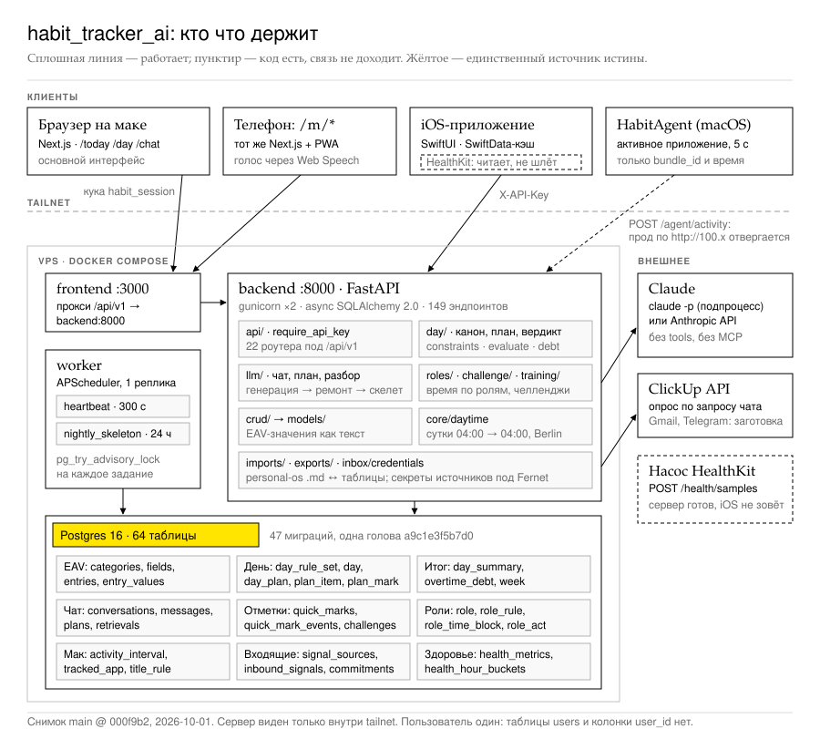
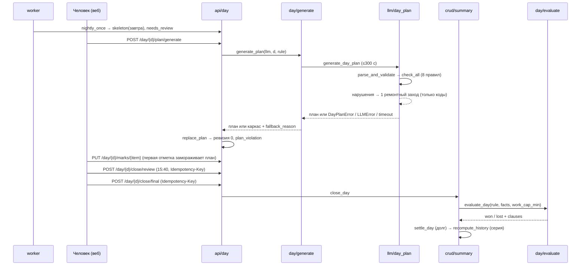

# habit_tracker_ai: как устроена система

Система состоит из одного FastAPI-бэкенда, одной базы Postgres и четырёх клиентов: веба на маке, мобильной веб-оболочки `/m`, iOS-приложения и агента на маке. Всё работает на одном VPS внутри Tailscale и закрыто одним ключом. Пользователь один.

Бизнес-решения принимают чистые модули: `app/day`, `app/roles`, `app/challenge`, `app/training`, `app/health`. Они не ходят в базу и не читают часы. `app/crud` загружает строки и записывает результаты.

LLM получает ограниченный контекст и отвечает JSON. Сервер проверяет ответ по схеме и правилам, а записывает в базу только по нажатию человека. Функциональное описание — в [парном документе](../../GENERAL/functional-spec/target-functional-spec.ru.md).

| Что | Как проверено |
|---|---|
| Тесты фронтенда: 1469 из 1470 проходят | `bun test`, прогнано 2026-10-01 |
| Голова цепочки миграций одна: `a9c1e3f5b7d0` | `uv run alembic heads`, прогнано |
| Версии библиотек бэкенда | `importlib.metadata`, прогнано |
| Баг генерации плана (`ValueError` мимо обработчиков) | Код прочитан и сверен по строкам; сценарий не прогонялся |
| 86 из 87 ссылок `file:line` из разведки | Сверены скриптом по содержимому строк |
| Тесты бэкенда (1540 функций в 91 файле) | **Не прогонялись**: нужен Postgres в Docker на 5433 |
| Swift-тесты (156 iOS, 22 агента) | **Не прогонялись** |



Две из пяти внешних связей на карте не работают: агент на маке не может отправить данные на прод по `http://100.x`, а iPhone не вызывает `POST /health/samples`. Остальные связи сходятся в одну базу.

---

## Модули и стек

Пути указаны от корня репозитория. `B` = `habit-tracker/services/backend/app`, `F` = `habit-tracker/services/frontend`.

| Модуль | Роль | Вход | Где |
|---|---|---|---|
| `main.py` | Собирает приложение: 22 роутера под `/api/v1`, CORS, публикация границы суток на старте | `create_app()` | [`B/main.py:128`](../../../habit-tracker/services/backend/app/main.py#L128) |
| `core/auth`, `core/session` | Проверяет ключ `X-API-Key` или подписанную куку `habit_session` | `require_api_key` | [`B/core/auth.py:89`](../../../habit-tracker/services/backend/app/core/auth.py#L89) |
| `core/daytime` | Задаёт границу суток 04:00, `local_date`, `day_bounds` | `local_date()` | [`B/core/daytime.py:151`](../../../habit-tracker/services/backend/app/core/daytime.py#L151) |
| `core/config` | Хранит настройки; в проде запрещает старт с дырой в периметре | `Settings` | [`B/core/config.py:245`](../../../habit-tracker/services/backend/app/core/config.py#L245) |
| `api/*` | 22 роутера, 147 эндпоинтов + `/` и `/health` | HTTP | [`B/api/`](../../../habit-tracker/services/backend/app/api/) |
| `crud/*` | Читает и записывает строки, управляет транзакциями | Вызовы из `api` | [`B/crud/`](../../../habit-tracker/services/backend/app/crud/) |
| `models/*` | 64 таблицы SQLAlchemy 2.0 | — | [`B/models/`](../../../habit-tracker/services/backend/app/models/) |
| `day/*` | Канон, план, 8 правил, каркас, генерация, вердикт, долг, неделя, отчёт | `evaluate_day()`, `generate_plan()` | [`B/day/`](../../../habit-tracker/services/backend/app/day/) |
| `roles/*` | Сопоставляет правила, задаёт старшинство источников, размечает день, делает пробный прогон | `classify_day()` | [`B/roles/classify.py:178`](../../../habit-tracker/services/backend/app/roles/classify.py#L178) |
| `challenge/rules.py` | Выносит вердикт дня и определяет исход челленджа | `verdict_for_day()` | [`B/challenge/rules.py:116`](../../../habit-tracker/services/backend/app/challenge/rules.py#L116) |
| `training/*` | Определяет состояние тела и гейты упражнений | `suggest()` | [`B/training/gates.py:202`](../../../habit-tracker/services/backend/app/training/gates.py#L202) |
| `health/*` | Каталог 24 метрик, единицы, часовые корзины | `aggregate` | [`B/health/aggregate.py:110`](../../../habit-tracker/services/backend/app/health/aggregate.py#L110) |
| `llm/*` | Клиенты Claude, промпты, план дня, разбор дня, онбординг, чат | `LLMClient.generate()` | [`B/llm/client.py:28`](../../../habit-tracker/services/backend/app/llm/client.py#L28) |
| `llm/chat/*` | Ведёт ход чата: карточка дня, выборки, разбор плашки, resume | `stream_turn()` | [`B/llm/chat/client.py:244`](../../../habit-tracker/services/backend/app/llm/chat/client.py#L244) |
| `imports/*`, `exports/*` | Переносит данные между personal-os markdown и таблицами | `import_root()` | [`B/imports/personal_os.py:1133`](../../../habit-tracker/services/backend/app/imports/personal_os.py#L1133) |
| `inbox/credentials.py` | Шифрует секреты источников | `encrypt/decrypt` | [`B/inbox/credentials.py:39`](../../../habit-tracker/services/backend/app/inbox/credentials.py#L39) |
| `worker.py`, `scheduling/registry.py` | APScheduler, реестр заданий, advisory lock | `python -m app.worker` | [`B/scheduling/registry.py:194`](../../../habit-tracker/services/backend/app/scheduling/registry.py#L194) |
| `jobs/nightly.py` | Создаёт каркас плана на завтра | `nightly_once()` | [`B/jobs/nightly.py:96`](../../../habit-tracker/services/backend/app/jobs/nightly.py#L96) |
| Веб `lib/api.ts` | Единственный HTTP-клиент, 22 объекта API | `fetcher<T>()` | [`F/lib/api.ts:62`](../../../habit-tracker/services/frontend/lib/api.ts#L62) |
| Веб `lib/routes.ts` | Реестр 18 экранов для обеих оболочек | `APP_ROUTES` | [`F/lib/routes.ts:98`](../../../habit-tracker/services/frontend/lib/routes.ts#L98) |
| Веб `hooks/*` | Хранит состояние экранов; страницы — тонкие обёртки | `useToday()` и др. | [`F/hooks/`](../../../habit-tracker/services/frontend/hooks/) |
| iOS `API/`, `Cache/` | Клиент, кэш чтения, офлайн-очередь | `APIClient` | [`OutboxQueue.swift:281`](../../../habit-tracker/ios/HabitTracker/HabitTracker/Cache/OutboxQueue.swift#L281) |
| Агент `Activity/`, `API/` | Наблюдает за активным приложением, собирает и отправляет интервалы | `IntervalBuilder` | [`IntervalBuilder.swift:45`](../../../habit-tracker/mac/HabitAgent/HabitAgent/Activity/IntervalBuilder.swift#L45) |

| Часть системы | Стек и версии |
|---|---|
| Бэкенд | Python 3.10, FastAPI 0.104.1, SQLAlchemy 2.0.23 + asyncpg 0.29, Alembic 1.12.1, Pydantic 2.5, APScheduler 3.11.3, anthropic 0.117.1, gunicorn 26 + uvicorn 0.24 |
| Веб | Next.js 16.1.6, React 19.2.3, Tailwind 4, recharts 3, тесты на `bun test` с happy-dom |
| iOS | SwiftUI, iOS 17, SwiftData, Swift Charts, HealthKit, без внешних пакетов |
| Агент | macOS 14, MenuBarExtra |
| База | Postgres 16 |

---

## Связи между модулями

Модули связаны прямыми вызовами внутри одного процесса и общей базой. Они не публикуют событий; очередей нет. Redis, Celery, Qdrant отсутствуют сознательно (ADR-0016, #108).

Граф [system-graph.html](system-graph.html) содержит 51 узел и 48 связей. Клик по узлу подсвечивает соседей и показывает путь к файлу. Граф открывается с `file://` без сети.

| От | К | Через | Где |
|---|---|---|---|
| Веб `lib/api.ts` | Next.js rewrites | HTTP `fetch /api/v1`, `credentials: include` | [`api.ts:62`](../../../habit-tracker/services/frontend/lib/api.ts#L62) |
| Next.js | backend | HTTP `/api/v1/*` → `API_PROXY_TARGET` | [`next.config.ts:15`](../../../habit-tracker/services/frontend/next.config.ts#L15) |
| iOS `APIClient` | backend | HTTP, заголовок `X-API-Key` из Keychain | [`APIClient.swift:336`](../../../habit-tracker/ios/HabitTracker/HabitTracker/API/APIClient.swift#L336) |
| iOS `OutboxQueue` | `POST /entries` | HTTP + `Idempotency-Key = PendingEntry.id` | [`OutboxQueue.swift:281`](../../../habit-tracker/ios/HabitTracker/HabitTracker/Cache/OutboxQueue.swift#L281) |
| Агент | `POST /agent/activity` | HTTP, только HTTPS или loopback | [`AgentAPIClient.swift:23`](../../../habit-tracker/mac/HabitAgent/HabitAgent/API/AgentAPIClient.swift#L23) |
| `main` | `core/auth` | `Depends(require_api_key)` на всех роутерах | [`main.py:160`](../../../habit-tracker/services/backend/app/main.py#L160) |
| `api/day` | `day/generate` | Вызов `generate_plan` без `signals` и `gates` | [`day.py:909`](../../../habit-tracker/services/backend/app/api/day.py#L909) |
| `day/generate` | `llm/day_plan` | Вызов `generate_day_plan`, бюджет 300 с | [`generate.py:143`](../../../habit-tracker/services/backend/app/day/generate.py#L143) |
| `day/generate` | `day/skeleton` | Вызов `_skeleton(reason)` при любом отказе | [`generate.py:139`](../../../habit-tracker/services/backend/app/day/generate.py#L139) |
| `llm/day_plan` | `day/constraints` | Вызов `check_all` внутри `parse_and_validate` | [`day_plan.py:218`](../../../habit-tracker/services/backend/app/llm/day_plan.py#L218) |
| `llm/day_plan` | `llm/plan_flow` | Вызов `generate_with_repair` | [`day_plan.py:225`](../../../habit-tracker/services/backend/app/llm/day_plan.py#L225) |
| `llm/client` | Claude | HTTP `messages.create` или подпроцесс `claude -p` | [`client.py:53`](../../../habit-tracker/services/backend/app/llm/client.py#L53), [`cli.py:39`](../../../habit-tracker/services/backend/app/llm/cli.py#L39) |
| `api/day` | `crud/plan` | Вызов `replace_plan` | [`day.py:910`](../../../habit-tracker/services/backend/app/api/day.py#L910) |
| `crud/plan` | `day_plan`, `plan_item`, `plan_mark` | База: delete → insert → восстановление отметок | [`plan.py:328`](../../../habit-tracker/services/backend/app/crud/plan.py#L328) |
| `crud/summary` | `day/evaluate` | Вызов `evaluate_day` | [`summary.py:795`](../../../habit-tracker/services/backend/app/crud/summary.py#L795) |
| `crud/summary` | `crud/day_profile` | Вызов `settle_day` (долг) | [`summary.py:676`](../../../habit-tracker/services/backend/app/crud/summary.py#L676) |
| `crud/day` | `core/daytime` | Вызов `publish_boundary` из действующей версии правил | [`day.py:109`](../../../habit-tracker/services/backend/app/crud/day.py#L109) |
| `api/chat` | `llm/chat/context` | Вызов `build_day_card` | [`context.py:350`](../../../habit-tracker/services/backend/app/llm/chat/context.py#L350) |
| `api/chat` | `llm/chat/client` | Вызов `stream_turn` | [`client.py:490`](../../../habit-tracker/services/backend/app/llm/chat/client.py#L490) |
| `api/chat` | `llm/chat/retrieval` | Вызов `run_need` по блоку `need` | [`retrieval.py:509`](../../../habit-tracker/services/backend/app/llm/chat/retrieval.py#L509) |
| `retrieval` | `crud/inbox` → ClickUp | Вызов `refresh_stale` → HTTP | [`retrieval.py:359`](../../../habit-tracker/services/backend/app/llm/chat/retrieval.py#L359), [`inbox.py:283`](../../../habit-tracker/services/backend/app/crud/inbox.py#L283) |
| `api/chat` | `chat_*` | База: `SELECT … FOR UPDATE` + строка `streaming` | [`chat.py:475`](../../../habit-tracker/services/backend/app/api/chat.py#L475) |
| `api/chat` apply | `crud/daily_summary` | Вызов `apply_daily_summary`, одна транзакция | [`chat.py:1239`](../../../habit-tracker/services/backend/app/api/chat.py#L1239), [`daily_summary.py:440`](../../../habit-tracker/services/backend/app/crud/daily_summary.py#L440) |
| `api/agent` | `roles/classify` | Вызов `classify_day` по затронутым дням | [`agent.py:144`](../../../habit-tracker/services/backend/app/api/agent.py#L144) |
| `roles/classify` | `roles/matcher` | Вызов `resolve_rule` | [`matcher.py:150`](../../../habit-tracker/services/backend/app/roles/matcher.py#L150) |
| `crud/quick_mark` | `quick_mark_events`, `entries`, `plan_mark` | База: `record_event` → `_close_planned_item` | [`quick_mark.py:451`](../../../habit-tracker/services/backend/app/crud/quick_mark.py#L451), [`:521`](../../../habit-tracker/services/backend/app/crud/quick_mark.py#L521) |
| `crud/challenge` | `challenge_days` | База: `materialize` при чтении | [`challenge.py:155`](../../../habit-tracker/services/backend/app/crud/challenge.py#L155) |
| `api/health` | `health_hour_buckets` | База: upsert корзин | [`health.py:31`](../../../habit-tracker/services/backend/app/api/health.py#L31) |
| `crud/inbox` | `inbox/credentials` | Вызов расшифровки секрета | [`credentials.py:39`](../../../habit-tracker/services/backend/app/inbox/credentials.py#L39) |
| `worker` | `jobs/nightly` | Вызов `JobRunner.run` под `pg_try_advisory_lock` | [`registry.py:194`](../../../habit-tracker/services/backend/app/scheduling/registry.py#L194) |
| `jobs/nightly` | `day/skeleton` → `day_plan` | Вызов + запись в базу, `needs_review = true` | [`nightly.py:96`](../../../habit-tracker/services/backend/app/jobs/nightly.py#L96) |

---

## Сценарий 1: от ночного каркаса до вердикта дня



### Ночь: каркас без модели

`nightly_once` ([`nightly.py:96`](../../../habit-tracker/services/backend/app/jobs/nightly.py#L96)) пишет каркас с `needs_review = True`, если правило есть, день рабочий и плана ещё нет. Функция берёт `pg_advisory_xact_lock` и считает завтра как `today_local() + 1`. Модель не вызывается.

### Генерация: план модели или каркас

`post_plan_generate` ([`day.py:878`](../../../habit-tracker/services/backend/app/api/day.py#L878)) вызывает `generate_plan` ([`generate.py:123`](../../../habit-tracker/services/backend/app/day/generate.py#L123)). Без модели функция сразу возвращает каркас с `llm_not_configured`.

С моделью `_TimedClient` ограничивает один вызов 120 с, а `wait_for` — всю генерацию 300 с. `generate_day_plan` вызывает `generate_with_repair` ([`plan_flow.py:79`](../../../habit-tracker/services/backend/app/llm/plan_flow.py#L79)): ответ → `parse_and_validate` (схема + `check_all`) → при ошибке один ремонтный промпт.

| Ошибка | Причина возврата каркаса |
|---|---|
| `TimeoutError` | `llm_timeout` |
| `DayPlanError` | `llm_plan_invalid` |
| `LLMError` | `llm_error` |

Принятый план ещё раз проходит `check_all` ([`generate.py:159`](../../../habit-tracker/services/backend/app/day/generate.py#L159)): проверяется именно документ, который пойдёт в базу.

### Запись и отметки

`replace_plan` ([`plan.py:328`](../../../habit-tracker/services/backend/app/crud/plan.py#L328)) проверяет документ, сохраняет снимок отметок пунктов, вернувших свой id, затем выполняет delete → insert, восстанавливает отметки и создаёт ревизию.

`set_mark` ([`mark.py:178`](../../../habit-tracker/services/backend/app/crud/mark.py#L178)) делает upsert по `item_id` и создаёт событие только при смене состояния. Первая отметка дня создаёт новую ревизию и снимает `needs_review`.

Быстрая отметка закрывает связанный пункт через `_close_planned_item`. Минуты работы считает `day_work_minutes` ([`work.py:110`](../../../habit-tracker/services/backend/app/day/work.py#L110)); если строк нет, возвращает `None`.

### Ревью, закрытие и вердикт

У `review_day` ([`summary.py:569`](../../../habit-tracker/services/backend/app/crud/summary.py#L569)) и `close_day` ([`summary.py:623`](../../../habit-tracker/services/backend/app/crud/summary.py#L623)) отдельные ключи идемпотентности. Тот же ключ на другой день даёт 409.

`evaluate_day` ([`evaluate.py:440`](../../../habit-tracker/services/backend/app/day/evaluate.py#L440)) строит условия в порядке `verdict_rule.reason_order`. Неизвестный код вызывает явную ошибку. Вердикт `lost` содержит код первого непройденного условия.

После закрытия `settle_day` ([`day_profile.py:359`](../../../habit-tracker/services/backend/app/crud/day_profile.py#L359)) начисляет и гасит долг. `recompute_history` ([`summary.py:718`](../../../habit-tracker/services/backend/app/crud/summary.py#L718)) пересчитывает вердикты закрытых дней и пишет `streak_after` через `step_streak` ([`streak.py:35`](../../../habit-tracker/services/backend/app/day/streak.py#L35)).

## Сценарий 2: ход чата с плашкой

### Проверка бэкенда и открытие хода

Без выбранного бэкенда `post_message` ([`chat.py:999`](../../../habit-tracker/services/backend/app/api/chat.py#L999)) возвращает 503 и не записывает реплику. Проверку выполняет `resolve_chat_client` ([`client.py:711`](../../../habit-tracker/services/backend/app/llm/chat/client.py#L711)).

`acquire_turn_slot` ([`limits.py:165`](../../../habit-tracker/services/backend/app/llm/chat/limits.py#L165)) ограничивает процесс двумя ходами через семафор. После 30 с ожидания возвращает 429.

`_open_turn` ([`chat.py:475`](../../../habit-tracker/services/backend/app/api/chat.py#L475)) открывает ход одной транзакцией:

1. Берёт разговор через `SELECT … FOR UPDATE`. Незакрытый ход даёт 409.
2. Собирает карточку дня и историю по `seq`, записывает реплику человека.
3. Создаёт строку ответа в статусе `streaming`. Эта строка служит замком разговора.

### Генерация и выборки

На время генерации сессия БД освобождается. Ход держит фабрику сессий, а не соединение ([`deps.py:50`](../../../habit-tracker/services/backend/app/api/deps.py#L50)).

`can_resume` ([`session.py:98`](../../../habit-tracker/services/backend/app/llm/chat/session.py#L98)) разрешает продолжить CLI-сессию, если совпали `session_id`, cwd, версия контекста и файл `.jsonl` на диске. Иначе вся история повторяется одним промптом.

Первый кадр извлекается до отправки заголовков ([`chat.py:1063`](../../../habit-tracker/services/backend/app/api/chat.py#L1063)). Сбой модели ещё можно вернуть кодом 502, а не ошибкой внутри потока 200.

`run_need` ([`retrieval.py:509`](../../../habit-tracker/services/backend/app/llm/chat/retrieval.py#L509)) разбирает и исполняет блок `need` из ответа. Результат возвращается модели следующим заходом; за ход их может быть до двух. Каждая выборка, включая отказ, записывается в `chat_retrievals`.

### Закрытие хода и применение плашки

В `finally` вызываются `_close_turn` и `_attach_plan` ([`chat.py:690`](../../../habit-tracker/services/backend/app/api/chat.py#L690)). Из текста извлекается последний JSON-объект с ключом `plan` ([`plan.py:69`](../../../habit-tracker/services/backend/app/llm/chat/plan.py#L69)). План, нарушающий правила дня, удаляется. Имя операции дня задаёт сервер.

Веб загружает плашку и отправляет выбранное подмножество с ключом. `apply_plan` ([`chat.py:1239`](../../../habit-tracker/services/backend/app/api/chat.py#L1239)) сверяет его с сохранённым планом через `narrow_to_plan`, затем записывает через `apply_daily_summary` или `replace_plan(author=AI)`. Остальные плашки на ту же дату становятся `stale`.

---

## Данные и ограничения базы

В базе 64 таблицы и 47 миграций. Цепочка линейная: от `10abe04ed653` до `a9c1e3f5b7d0`. Единственный PG-enum — `fieldtype`; остальные словари представлены строкой с CHECK или таблицей-каталогом.

| Домен | Таблицы |
|---|---|
| EAV | `categories`, `fields`, `entries`, `entry_values` |
| День | `day_rule_set`, `day`, `day_plan`, `plan_section`, `plan_item`, `plan_mark`, `plan_mark_event`, `plan_revision`, `plan_item_change`, `plan_violation`, `day_anchor`, `anchor_kind`, `work_interval` |
| Итоги | `day_summary`, `day_report`, `week`, `week_review_item`, `day_rule_profile`, `day_rule_activation`, `overtime_debt` |
| Отметки | `quick_marks`, `quick_mark_events`, `challenges`, `challenge_days` |
| Роли и мак | `role`, `role_rule`, `role_time_block`, `role_act`, `activity_interval`, `tracked_app`, `title_rule`, `agent_heartbeat`, `claude_session`, `agent_setting`, `mode_schedule`, `day_mode` |
| Чат | `chat_conversations`, `chat_messages`, `chat_plans`, `chat_retrievals` |
| Здоровье | `health_metrics`, `health_hour_buckets` |
| Входящие | `signal_sources`, `signal_scopes`, `inbound_signals`, `commitments`, `signal_mirror_ops` |
| Прочее | `goal_level`, `milestone`, `milestone_dep`, `quarter_goal`, `journal_entries`, `training_day`, `training_state`, `body_complaint`, `personal_record`, `ai_reports`, `applied_daily_summaries`, `transcripts`, `import_source` |

### Ядро EAV

Сокращённый фрагмент [`10abe04ed653_initial_migration.py`](../../../habit-tracker/services/backend/alembic/versions/2026_02_06_2051-10abe04ed653_initial_migration.py):

```python
op.create_table('categories', id Integer PK, name String(100) NOT NULL, description Text,
    icon String(50), color String(7), is_active Boolean NULL, created_at/updated_at tz now())
op.create_index('ix_categories_name', 'categories', ['name'], unique=True)
op.create_table('fields', id PK, category_id NOT NULL, name String(100),
    sa.Column('field_type', sa.Enum('TEXT','NUMBER','BOOLEAN','DATE','DATETIME','TIME','SELECT', name='fieldtype')),
    is_required Boolean, default_value String(255), options String(500), order Integer,
    FK category_id -> categories.id CASCADE)
op.create_table('entries', id PK, category_id Integer NOT NULL, entry_date Date NOT NULL, notes Text,
    FK category_id -> categories.id CASCADE)
op.create_table('entry_values', id PK, entry_id NOT NULL, field_id NOT NULL, value Text,
    FK entry_id -> entries.id CASCADE, FK field_id -> fields.id CASCADE)
```

| Что добавлено позже | Детали |
|---|---|
| Значение enum | `DURATION` через `autocommit_block` ([`a1c2d3e4f5a6`](../../../habit-tracker/services/backend/alembic/versions/2026_07_23_1200-a1c2d3e4f5a6_field_type_duration.py)) |
| Поля категорий | `display_mode`, `group`, `streak_mode`, `show_in_today`, `primary_field_id` |
| Поле записей | `idempotency_key` с уникальным индексом |
| Поля полей | `unit`, `quick_steps` |
| Индекс | `(category_id, entry_date)` |

### Канон дня

[`c8e0a2b4d6f9_day_and_rule_set.py`](../../../habit-tracker/services/backend/alembic/versions/2026_08_30_1200-c8e0a2b4d6f9_day_and_rule_set.py):

```python
op.create_table("day_rule_set", id PK, valid_from Date NOT NULL, valid_to Date NULL,
    timezone String(64) DEFAULT 'Europe/Berlin', day_start_hour SmallInteger DEFAULT 4,
    work_cap_min DEFAULT 480, work_hard_cap_min DEFAULT 540, work_stop_at Time DEFAULT '16:00',
    max_work_tasks DEFAULT 4, tasks_required_ratio Numeric(3,2) DEFAULT 1.00, ...)
op.execute("ALTER TABLE day_rule_set ADD CONSTRAINT excl_day_rule_set_no_overlap "
           "EXCLUDE USING gist (daterange(valid_from, valid_to, '[)') WITH &&)")
```

### Пункт плана

Правила строки заданы в базе. Сервис дублирует их только ради текста ошибки ([`d9f1b3c5e7a0_plan_tables.py`](../../../habit-tracker/services/backend/alembic/versions/2026_08_30_1600-d9f1b3c5e7a0_plan_tables.py)):

```python
sa.Column("window", TSTZRANGE, sa.Computed("tstzrange(starts_at, ends_at)", persisted=True)),
sa.Column("search", TSVECTOR, sa.Computed("to_tsvector('russian', text_plain)", persisted=True)),
CheckConstraint("kind <> 'task' OR (starts_at IS NOT NULL AND ends_at IS NOT NULL AND done_criterion IS NOT NULL)"),
CheckConstraint("rigidity <> 'free' OR starts_at IS NULL"),
CheckConstraint("kind <> 'task' OR quarter_goal_id IS NOT NULL OR unlinked_reason IS NOT NULL"),
# позже, b2d4f6a8c0e3:
"UNIQUE NULLS NOT DISTINCT (section_id, parent_id, ord) DEFERRABLE INITIALLY DEFERRED"
```

### Кто записывает данные

| Таблица | Кто пишет |
|---|---|
| `entries`, `entry_values` | Формы, разбор дня, плашки чата, быстрые отметки |
| `day_plan` и пункты | `replace_plan` (человек, модель, каркас, импорт) и правка пункта |
| `plan_mark` | `set_mark` и быстрые отметки |
| `day_summary` | Только два касания закрытия и импорт |
| `role_time_block` | `classify_day` и ручной ввод |
| `activity_interval` | Только агент и ручная правка |

---

## Технические принципы (CS)

| Идея | Где | Зачем здесь | Без неё |
|---|---|---|---|
| EAV (сущность-атрибут-значение) | [`models/entry_value.py:17`](../../../habit-tracker/services/backend/app/models/entry_value.py#L17), [`crud/values.py:8`](../../../habit-tracker/services/backend/app/crud/values.py#L8) | Человек заводит категории и поля без миграций | Каждая новая привычка требует новой таблицы и деплоя |
| Версии по времени на полуинтервалах + EXCLUDE | [`models/day.py:121`](../../../habit-tracker/services/backend/app/models/day.py#L121), [`day/rules.py:277`](../../../habit-tracker/services/backend/app/day/rules.py#L277) | Прошлый день оценивается по правилу своего времени | Смена потолка задним числом переписала бы все вердикты |
| Чистая функция решения | [`day/evaluate.py:440`](../../../habit-tracker/services/backend/app/day/evaluate.py#L440) | Вердикт тестируется без базы и часов; пересчёт истории детерминирован | Вердикт зависел бы от порядка запросов и текущего времени |
| Порядок правил как данные | `verdict_rule.reason_order`, [`evaluate.py:167`](../../../habit-tracker/services/backend/app/day/evaluate.py#L167) | Приоритет условий меняется через INSERT новой версии правил | Каждая правка канона требовала бы правки кода |
| Цикл «генерация → проверка → ремонт» и детерминированный каркас | [`plan_flow.py:79`](../../../habit-tracker/services/backend/app/llm/plan_flow.py#L79), [`generate.py:123`](../../../habit-tracker/services/backend/app/day/generate.py#L123) | При ошибке модели день всё равно получает валидный план | День оставался бы пустым при каждом сбое модели |
| Идемпотентный ключ клиента | [`api/entries.py:153`](../../../habit-tracker/services/backend/app/api/entries.py#L153) | Повтор после потерянного ответа не создаёт дубль | Офлайн-очередь и двойной клик создавали бы двойные записи |
| Естественный ключ + upsert | `activity_interval (source, started_at, app_id)`, `health_hour_buckets (metric, date, hour)` | Позволяет отправлять потоковые пачки без состояния на клиенте | Каждый повтор агента удваивал бы время |
| Пессимистичная блокировка строки | `SELECT … FOR UPDATE`, [`chat.py:475`](../../../habit-tracker/services/backend/app/api/chat.py#L475) | Два хода в один разговор не перемешивают историю | Перепутанный `seq` и два ответа на одну реплику |
| Advisory lock по хешу имени | [`core/locks.py:25`](../../../habit-tracker/services/backend/app/core/locks.py#L25), [`registry.py:194`](../../../habit-tracker/services/backend/app/scheduling/registry.py#L194) | Одно задание не запускается дважды даже при двух воркерах | Два каркаса на один день |
| Арифметика интервалов `merge`/`subtract` | [`roles/precedence.py:89`](../../../habit-tracker/services/backend/app/roles/precedence.py#L89) | Сильный источник забирает часы у слабого; время не считается дважды | 12 часов ролей в 8-часовом дне |
| Конечный автомат интервала | [`IntervalBuilder.swift:45`](../../../habit-tracker/mac/HabitAgent/HabitAgent/Activity/IntervalBuilder.swift#L45) | Превращает наблюдения раз в 5 с в ~300 строк в день | 17 280 строк в сутки |
| Outbox с удалением после успеха | [`OutboxQueue.swift:281`](../../../habit-tracker/ios/HabitTracker/HabitTracker/Cache/OutboxQueue.swift#L281) | Запись без сети отправляется позже, по порядку и без дублей | Записи терялись бы в зале без сети |
| Read-through кэш с меткой устаревания | [`CacheStore.swift:77`](../../../habit-tracker/ios/HabitTracker/HabitTracker/Cache/CacheStore.swift#L77) | Без сети показывает старые данные и время их получения | Пустой экран или старые данные под видом свежих |
| Белый список запросов вместо tools | [`retrieval.py:398`](../../../habit-tracker/services/backend/app/llm/chat/retrieval.py#L398) | Модель видит только именованные выборки с ограничениями | Произвольные запросы модели к личным данным |
| Права через типы | `ChatPlan` без операций удаления, [`schemas/chat.py:312`](../../../habit-tracker/services/backend/app/schemas/chat.py#L312) | Ответ модели не может выразить разрушительную операцию | Защита держалась бы на промпте |
| Ограниченный контекст по приоритетам | [`context.py:350`](../../../habit-tracker/services/backend/app/llm/chat/context.py#L350) | Карточка ≤ 20 000 символов; первой удаляется наименее важная секция | Переполнение окна или строка, обрезанная посреди факта |
| Envelope-like: KDF из существующего секрета | [`credentials.py:39`](../../../habit-tracker/services/backend/app/inbox/credentials.py#L39) | Ключ Fernet выводится HKDF-SHA256 из `SESSION_SECRET` | Второй секрет в окружении или секреты в открытом виде |
| Stateless-сессия с подписью | [`core/session.py:68`](../../../habit-tracker/services/backend/app/core/session.py#L68) | Ключ API не хранится в браузере; хранилище сессий не нужно | Ключ в localStorage и в бандле |
| ETag по всему телу ответа | [`api/quick_marks.py:77`](../../../habit-tracker/services/backend/app/api/quick_marks.py#L77) | Агент опрашивает раз в 15 с и получает 304 | Полный ответ каждые 15 секунд |
| Stored generated columns + GiST/GIN | [`models/plan.py:444`](../../../habit-tracker/services/backend/app/models/plan.py#L444) | Пересечения окон находятся одним SQL по `&&`; доступен поиск по тексту плана | Пересечения пришлось бы считать в Python по всем строкам |

---

## Что перенести в другой проект

Технические рецепты к разделу 15 функционального описания: что взять, где смотреть и что исправить при переносе.

### Динамические категории (EAV)

Четыре таблицы позволяют заводить категории и поля без миграций:

| Таблица | Что хранит |
|---|---|
| `categories` | Сущность |
| `fields` | Атрибуты с `field_type`, `order`, `unit`, `quick_steps` |
| `entries` | Запись на дату |
| `entry_values` | Значения в `Text` |

| Что взять | Как устроено |
|---|---|
| Чтение по типу в одном модуле | Значение всегда хранится как текст. Тип применяется при чтении в `crud/values.py`: истина `{"true","1","yes"}`, `parse_number`, `format_number` убирает `.0` |
| Агрегация по типу | Числа и длительности суммируются, флажки дают «хоть одно да», остальные типы — последнее значение ([`crud/table.py:29`](../../../habit-tracker/services/backend/app/crud/table.py#L29)) |
| Синхронизация полей по `id` | Клиент отправляет полный список. Поле с `id` обновляется на месте, история сохраняется. Иначе переименование поля стирало бы его значения ([`crud/category.py:56`](../../../habit-tracker/services/backend/app/crud/category.py#L56)) |
| Порядок полей как часть контракта | `relationship(order_by=(Field.order, Field.id))` ([`models/category.py:64`](../../../habit-tracker/services/backend/app/models/category.py#L64)) |
| Пакетная операция | `POST /categories/batch`: дискриминированный union `create_category | add_field` в одной транзакции. На него опирается LLM-конструктор |
| Трёхзначный флаг `show_in_today` | `null` — решает эвристика, `true`/`false` — человек |

При переносе проверяй значение по типу и `is_required` на сервере, а не только в форме. Добавь `UNIQUE (entry_id, field_id)` и храни `options` в одном формате.

### LLM, который не может испортить данные

Запись идёт через плашку, подтверждение человека и существующий транзакционный путь. Сервер сверяет присланное подмножество с сохранённым, задаёт имя операции, повторно проверяет данные перед записью и требует `Idempotency-Key`.

| Что взять | Как устроено |
|---|---|
| Единый транспорт | Интерфейс `LLMClient.generate(prompt) -> str` и два бэкенда: SDK и подпроцесс `claude -p` |
| Изоляция CLI | Флаги собраны в один кортеж: `--tools ""`, `--setting-sources ""`, `--strict-mcp-config` ([`cli.py:39`](../../../habit-tracker/services/backend/app/llm/cli.py#L39)). Замер первого хода: 52 555 токенов без флагов против 282 с ними (`habit-tracker/docs/llm-cli-isolation.md`) |
| Проверка ответа | Pydantic `extra="forbid"`, затем проверка смысла: ссылки по id и правила дня. Обе проверки находятся в одной функции разбора, чтобы ремонт исправлял и доменные ошибки |
| Ремонтный промпт без личных данных | Только коды правил и коды строк ([`day_plan.py:170`](../../../habit-tracker/services/backend/app/llm/day_plan.py#L170)) |
| Каталог по id в промпте | Модель ссылается на поля только номером; коллизии решает сервер ([`llm/daily_summary.py:117`](../../../habit-tracker/services/backend/app/llm/daily_summary.py#L117)) |

### Версии правил и граница суток

Правила хранятся версиями с `valid_from`/`valid_to` и `EXCLUDE USING gist`. Новая версия создаётся через INSERT в SAVEPOINT вместе с закрытием старой. PUT и DELETE нет.

«Сегодня» определяется в одной функции: `local_date(at)` отвергает время без пояса, а `day_bounds(d)` возвращает UTC-полуинтервал для SQL. На старте процесса граница публикуется из действующей строки правил.

### Идемпотентность и офлайн

Клиентский ключ и уникальное ограничение защищают от повторной записи. Гонка двух запросов обрабатывается через `IntegrityError` ([`api/entries.py:153`](../../../habit-tracker/services/backend/app/api/entries.py#L153)).

Квитанция применения в `applied_daily_summaries` хранит исходный ответ. Повтор возвращает его байт в байт.

| Механизм | Поведение |
|---|---|
| Ключ iOS outbox | `PendingEntry.id` остаётся стабильным |
| Порядок и удаление в iOS outbox | Записи идут по `createdAt` и удаляются только после 2xx |
| Ошибки iOS outbox | Ошибка сети останавливает очередь; другая ошибка паркует запись после 5 попыток |
| Возврат сети на iOS | `NWPathMonitor` запускает отправку |
| Отправка агента | Single-flight, экспоненциальная пауза 30 → 600 с. Отказ 422 исключает конкретное приложение, а не пачку ([`IntervalOutbox.swift:44`](../../../habit-tracker/mac/HabitAgent/HabitAgent/Activity/IntervalOutbox.swift#L44)) |

### Приоритет ручного ввода закреплён в записи

Автоматика не перезаписывает ручной ввод: для дней челленджа это гарантирует SQL, для разметки ролей — флаг `confirmed`.

| Механизм | Как устроено |
|---|---|
| Защита дней челленджа в SQL | `ON CONFLICT … DO UPDATE … WHERE source <> 'manual'` ([`crud/challenge.py:155`](../../../habit-tracker/services/backend/app/crud/challenge.py#L155)) |
| Защита разметки ролей | Автоматика не трогает строки с `confirmed` |
| Сохранение истории | В `plan_mark_event` и `quick_mark_events` можно только дописывать. Журналы не имеют FK и хранят денормализованную дату, поэтому переживают удаление пункта |

### Фоновые задания без Celery

`JobRunner` запускает задание под `pg_try_advisory_lock(blake2b(name))`, ограничивает время через `wait_for(timeout)` и пишет в лог только класс исключения.

Реестр `ScheduledJob` требует имя в `lower_snake_case`, таймаут и описание. Дубль имени вызывает ошибку. При SIGTERM планировщик ставится на паузу, дожидается текущих заданий и завершает работу.

### Веб

Обе оболочки используют один реестр экранов и общую логику в хуках. Страницы остаются тонкими обёртками с флагом `compact`.

| Что взять | Как устроено |
|---|---|
| Реестр экранов | Единственный источник навигации для обеих оболочек |
| Резолвер горячих клавиш | Чистая функция с запасным вариантом по физической клавише (`KeyP`). Буквы работают в русской раскладке ([`quick-mark-hotkeys.ts:89`](../../../habit-tracker/services/frontend/lib/quick-mark-hotkeys.ts#L89)) |
| SSE-парсер | Чистый класс с discriminated union событий. Мысль модели отделена от текста ответа ([`chat-stream.ts:12`](../../../habit-tracker/services/frontend/lib/chat-stream.ts#L12)) |
| Оптимистичная запись | Отрицательный локальный id, точечный откат и слияние со снимком сервера ([`useToday.ts:313`](../../../habit-tracker/services/frontend/hooks/useToday.ts#L313)) |

### База

Ограничения заданы в базе, а миграции исправляют данные без удаления.

| Что взять | Как устроено |
|---|---|
| Общий словарь CHECK | Один кортеж читают модель и миграция ([`models/checks.py:19`](../../../habit-tracker/services/backend/app/models/checks.py#L19)) |
| Таблица-одиночка | `CHECK (id = 1)` |
| Частичные UNIQUE | «Ровно один профиль по умолчанию», необязательная клавиша, ключ импорта |
| Исправление данных в миграциях | Перенумерация дублей оконной функцией; перенос висящего FK в текстовую причину |

---

## Границы и риски

Первый баг сверен по строкам кода. Остальные пункты взяты из разведки и не прогонялись.

### Баги

1. **Генерация плана возвращает 500 вместо каркаса, если в ответе модели нет `{`.** `extract_json` бросает `ValueError` ([`plan_flow.py:41`](../../../habit-tracker/services/backend/app/llm/plan_flow.py#L41)). `parse_plan` ловит только `PlanError` ([`day_plan.py:140`](../../../habit-tracker/services/backend/app/llm/day_plan.py#L140)), который наследует `Exception`, а не `ValueError`. Ни `generate_with_repair`, ни `generate_plan` не ловят `ValueError`. Теста на этот случай нет.

2. **Модель не получает два правила, по которым проверяется её ответ:** `relationship_anchor_required` и `max_study_items`. Промпт `DAY_PLAN_PROMPT` и `_canon` их не упоминают ([`day_plan.py:62`](../../../habit-tracker/services/backend/app/llm/day_plan.py#L62)), но `check_all` проверяет.

3. **Генерация не получает `signals` и `gates`** ([`day.py:909`](../../../habit-tracker/services/backend/app/api/day.py#L909)). Переносы задач всегда передаются каркасу пустым списком.

4. **Повторная разметка ролей по данным агента обнуляет роли.** `historical_samples` не восстанавливает `bundle_id` ([`samples.py:86`](../../../habit-tracker/services/backend/app/roles/samples.py#L86)). Поэтому `reclassify` переводит неподтверждённые строки `app_usage` в `unassigned`.

5. **Публикация версии правил сбрасывает поля карты дня, якорей и порядка вердикта к значениям по умолчанию.** Место: [`day_rules.py:116`](../../../habit-tracker/services/backend/app/crud/day_rules.py#L116).

6. **Предложение поднять потолок никогда не появляется.** `deadline_signals` всегда равен `[]` ([`day_profile.py:425`](../../../habit-tracker/services/backend/app/crud/day_profile.py#L425)).

7. **Веб отправляет тап быстрой отметки без `Idempotency-Key`** ([`useQuickMarks.ts:84`](../../../habit-tracker/services/frontend/hooks/useQuickMarks.ts#L84)). Функция `tapQuickMark` с ключом и повтором есть ([`useToday.ts:232`](../../../habit-tracker/services/frontend/hooks/useToday.ts#L232)). Закрытие дня в `DayScreen` тоже идёт без ключа.

8. **С 00:00 до 04:00 запись уходит в другой день.** Веб-Today и iOS считают «сегодня» по полуночи устройства, сервер — по 04:00.

9. **Поток чата при 401 не переводит на `/login`.**

10. **iOS «Check connection» сообщает «успех» при неверном ключе.** Проверка вызывает `GET /`, который находится вне периметра. Записи, застрявшие после 5 ошибок, например после 401, не видны и не возвращаются в очередь.

### Нагрузка и эксплуатация

| Проблема | Причина или последствие |
|---|---|
| Лимит чата выше обещанного | Слоты считаются на процесс. В проде 2 воркера gunicorn: до 4 одновременных ходов вместо 2 из ADR-0017 |
| CLI-сессии теряются при перезапуске контейнера | `/data/claude-chat` не смонтирован томом. Вместо resume повторяется история |
| Закрытие дня пересчитывает всю историю | `recompute_history` на каждое касание закрытия делает около 6 запросов на каждый закрытый день: N+1 по всей истории |
| LLM-вызовы занимают соединения с базой | Инсайты, разбор дня, онбординг и генерация плана держат соединение до 300 с |
| Миграции выполняются после запуска контейнеров | Такой порядок задан в `make deploy` |
| Клиенты не показывают старые записи | Каждый клиент подставляет 100 записей по умолчанию. iOS-экраны не видят старше 100, веб-ленты — старше 50 |
| Health теряет семплы одного часа из разных пакетов | Корзина часа перезаписывается целиком |

### Тесты

`app/m/health/page.test.tsx` проходит отдельно, но падает в общем прогоне. Десять тестов подменяют `@/lib/api` через `mock.module` без `healthAPI`. В bun эта подмена действует на весь процесс.

CHECK на `challenges.rule_kind`, `failure_mode` и `challenge_days.verdict` есть только в миграции. Тестовая база, созданная через `create_all`, их не получает.

### Ошибки в документах

| Документ | Что неверно |
|---|---|
| `habit-tracker/ARCHITECTURE.md` | Описывает несуществующую `parse_value` |
| `habit-tracker/docs/day-boundary.md:79-84` | Утверждение про UTC у серий |
| `habit-tracker/docs/day-plan.md:160-162` | «Вердикта нет» |
| `docs/ROADMAP/STATUS.md` | Устаревшие счётчики и «каталога mac нет» |
| `QUICKSTART.md` | Совет удалить миграции |

---

## Как проверить самому

### Тесты фронтенда

```bash
cd habit-tracker/services/frontend && bun test
```

Ожидается `1469 pass, 1 fail`: падает изоляция `app/m/health`.

```bash
cd habit-tracker/services/frontend && bun test app/m/health
```

Ожидается `2 pass, 0 fail`: отдельно тот же файл проходит.

### Миграции и проверки бэкенда

```bash
cd habit-tracker/services/backend && uv run alembic heads
```

Ожидается одна строка: `a9c1e3f5b7d0 (head)`.

```bash
cd habit-tracker/services/backend && make check
```

Ожидается, что ruff, `mypy --strict`, проверка одной головы и pytest пройдут. Команда поднимает Postgres в Docker на 5433. В этом разборе она не прогонялась.

### Проверка живого CLI

```bash
cd habit-tracker/services/backend && make smoke
```

Запускает живой `claude -p` с порогом 1000 токенов на первый ход. Нужен CLI с выполненным входом. Проверка не прогонялась.

### Проверка графа

```bash
python3 ~/.claude/skills/explain-system/scripts/build-graph.py docs/explanations/system/graph.json --check
```

Ожидается: `ок: 51 узлов, 48 рёбер, все пути на месте`.

---

## Что почитать дальше

### В репозитории

| Документ | Тема |
|---|---|
| [`habit-tracker/docs/day-plan.md`](../../../habit-tracker/docs/day-plan.md) | Контракт плана дня |
| [`habit-tracker/docs/day-boundary.md`](../../../habit-tracker/docs/day-boundary.md) | Граница суток и DST |
| [`habit-tracker/docs/llm-cli-isolation.md`](../../../habit-tracker/docs/llm-cli-isolation.md) | Изоляция CLI и замеры токенов |
| [`habit-tracker/docs/quick-marks-agent-contract.md`](../../../habit-tracker/docs/quick-marks-agent-contract.md) | Контракт кнопок для агента |
| [ADR-0014](../../PHASE-03/ADRs/in-review/ADR-0014-day-in-postgres.md) | День в Postgres |
| [ADR-0015](../../PHASE-03/ADRs/in-review/ADR-0015-plan-generation-loop.md) | Цикл генерации |
| [ADR-0017](../../PHASE-03/ADRs/in-review/ADR-0017-claude-chat-agent.md) | Чат |
| [ADR-0018](../../PHASE-03/ADRs/in-review/ADR-0018-challenges-and-quick-marks.md) | Челленджи и отметки |
| [ADR-0019](../../PHASE-03/ADRs/in-review/ADR-0019-mac-local-agent.md) | Агент |
| [ADR-0020](../../PHASE-03/ADRs/in-review/ADR-0020-healthkit-and-cto-metrics.md) | HealthKit и роли |
| [ADR-0021](../../PHASE-03/ADRs/in-review/ADR-0021-chat-rewrites-the-day-plan.md) | Перезапись плана чатом |
| [ADR-0002](../../PHASE-01/ADRs/done/ADR-0002-online-first-cache-queue.md) | Офлайн iOS |

### Первоисточники по техническим принципам

| Тема | Источник |
|---|---|
| EAV и его цена | Karwin, *SQL Antipatterns*, глава «Entity-Attribute-Value» |
| Темпоральные таблицы | Snodgrass, *Developing Time-Oriented Database Applications in SQL*; PostgreSQL docs, «Exclusion Constraints» и «Range Types» |
| Идемпотентные ключи | Stripe API docs, «Idempotent requests»; IETF draft «The Idempotency-Key HTTP Header Field» |
| Outbox и доставка at-least-once | Kleppmann, *Designing Data-Intensive Applications*, гл. 11 |
| Advisory locks | PostgreSQL docs, «Explicit Locking — Advisory Locks» |
| Генерация с проверкой и ремонтом | Anthropic docs, «Increase output consistency» и «Reduce hallucinations» |
